# Student–LLM Interaction Analysis: Clustering, Treatment Classification, and SHAP Explainability

**Project Continuation & Explainable AI Report**
**Dataset:** `ProcessedDatasets/student_features_final.csv` (518 students, 33 features) & `cleaned_user_messages.csv` (28,664 student messages)
**Unified Pipeline:** `run_full_pipeline.py` & `Student_LLM_Unified_Pipeline_SHAP.ipynb`

---

## 1. Abstract

This study investigates how secondary students (Grades 9–11; $N = 518$, $28{,}664$ prompts) interact with a Large Language Model (LLM) across two experimental conditions (`aug`, $n = 277$; `vanilla`, $n = 241$). Continuing from the completed preprocessing stage (`ProcessedDatasets/`) and the three-experiment design (`E1`, `E2`, `E3`) introduced in `Regression.py`, we implement a single end-to-end, leakage-free analytical pipeline combining unsupervised clustering, supervised treatment classification, Shapley Additive Explanations (SHAP), and non-parametric statistical testing.

K-Means clustering ($k = 4$) on nine log-transformed and standardized primary interaction features identifies four distinct student profiles that strongly associate with treatment group ($\chi^2 = 194.18$, $p < 0.001$, Cramér's $V = 0.6123$) and modestly associate with grade ($\chi^2 = 38.04$, $p < 0.001$, Cramér's $V = 0.1916$). In supervised classification across five model families, interaction features alone (`E1_Primary`) distinguish `aug` from `vanilla` with a 5-fold cross-validation ROC-AUC of **0.9106** (HistGradientBoosting; hold-out test ROC-AUC = **0.9025**), while adding sparse behavioural features (`E2_Primary_Sparse`) yields a hold-out test ROC-AUC of **0.9222** (Gradient Boosting). Adding grade metadata (`E3_Combined_Grade`) produces negligible CV ROC-AUC change (best CV ROC-AUC = **0.9083**, Random Forest; hold-out test ROC-AUC = **0.9156**), confirming that classification is driven primarily by interaction behaviour rather than grade imbalance alone. SHAP (`TreeExplainer`) reveals that `student_message_count` is the single strongest predictor (mean $|\text{SHAP}| = 1.4645$ in `E1`), with higher message volume strongly pushing predictions toward `aug` ($\rho = +0.899$), whereas higher `verification_request_rate` ($\rho = -0.617$), `average_word_count` ($\rho = -0.716$), and `conceptual_question_rate` ($\rho = -0.918$) push predictions toward `vanilla`. All results are observational and describe predictive associations with treatment group rather than causal learning gains.

---

## 2. Introduction

As Large Language Models become integrated into secondary and higher education, understanding *how* students converse with AI tools—whether they send brief iterative turns, paste code, request complete solutions, verify answers, or ask conceptual questions—is essential for educational data mining. However, raw predictive accuracy alone does not reveal which behavioural patterns distinguish experimental conditions or whether demographic metadata confounds model predictions.

This report documents the unified continuation of the team's data mining project:
1. **Preprocessing (Completed by Srijan):** Cleaned $28{,}664$ student prompts and aggregated them into $518$ student-level behavioural records (`student_features_final.csv`) with documented transformation settings (`preprocessing_config.json`).
2. **Experimental Design (Initiated by Shivesh):** Structured the progressive feature experiments (`E1`: primary interaction features; `E2`: primary + sparse rates and binary flags; `E3`: combined + `grade`) in `Regression.py` with training-fold-only `log1p` + `StandardScaler` preprocessing. Because `student_features_final.csv` contains binary `treatment` (`aug` vs. `vanilla`) and no continuous academic outcome column, the unified pipeline preserves Shivesh's exact `E1`/`E2`/`E3` feature groups and preprocessing structure while adapting the estimators to stratified binary classification.
3. **Clustering, Experimental Comparison, SHAP Explainability & Statistical Interpretation (Completed by Shreyansh):** Executed all remaining workflow stages—unsupervised student profiling, multi-model `E1`/`E2`/`E3` evaluation, global/local SHAP explainability, grade-confounding sensitivity checks, and prompt-level auditing—in one reproducible process.

---

## 3. Research Objectives and Questions

1. **Objective A (Unsupervised Interaction Profiles):** Can students be grouped into interpretable behavioural profiles based purely on their LLM interaction metrics, and how do those profiles distribute across `treatment` and `grade`?
2. **Objective B (Supervised Treatment Classification across E1–E3):** How accurately can behavioural interaction features distinguish `aug` from `vanilla`, and do sparse features (`E2`) or grade metadata (`E3`) improve predictive performance?
3. **Objective C (Explainable AI via SHAP):** Which behavioural features contribute most to the best-performing classifier's predictions, in what direction do they shift predicted probabilities, and are SHAP attributions consistent with non-parametric statistical tests?
4. **Objective D (Confounding & Data Quality Audit):** To what extent does grade imbalance confound treatment classification, and what limitations exist in the rule-based behavioural labels?

---

## 4. Dataset Description

All three files in `ProcessedDatasets/` were audited prior to modelling:

| Audit Check | Verified Result |
|---|---|
| Student records (`student_features_final.csv`) | 518 rows × 33 columns |
| Unique students (`username`) | 518 (0 duplicates) |
| Missing / infinite numeric values | 0 missing, 0 infinite |
| Message records (`cleaned_user_messages.csv`) | 28,664 rows × 23 columns |
| Treatment distribution | `aug`: 277 (53.5%), `vanilla`: 241 (46.5%) |
| Grade distribution | Grade 9: 214, Grade 10: 211, Grade 11: 93 |
| Session message counts | Session 1: 5,449; Session 2: 7,209; Session 3: 8,281; Session 4: 7,725 |

**Critical Scope Note:** The dataset contains no independent academic outcome (e.g., exam score or GPA). Accordingly, `treatment` is the sole valid supervised target, and no claims are made regarding learning gains or academic achievement.

---

## 5. Data Preprocessing

Following `preprocessing_config.json` and `Regression.py`:
- **Primary interaction features (9):** `student_message_count`, `average_word_count`, `average_question_count`, `explanation_request_rate`, `complete_solution_request_rate`, `verification_request_rate`, `conceptual_question_rate`, `code_prompt_rate`, `followup_prompt_rate`.
- **Supplementary sparse features (6):** Rates (`hint_request_rate`, `refinement_request_rate`, `multiple_question_rate`) and binary indicators (`hint_request_present`, `refinement_request_present`, `multiple_question_present`), which are non-zero for only 7.14%, 3.09%, and 5.79% of students respectively.
- **Transformation & Leakage Prevention:** All continuous features exhibit strong right skewness (skewness from $1.043$ for `student_message_count` to $8.179$ for `average_question_count`). Every supervised model applies `np.log1p` followed by `StandardScaler` inside a scikit-learn `ColumnTransformer` + `Pipeline`, fitted strictly on training folds only. Categorical `grade` (in `E3`) is one-hot encoded (`drop="first"`), while binary sparse flags pass through unchanged. `username` and `treatment` are strictly excluded from all predictor matrices.

---

## 6. Feature Engineering

The existing student-level feature engineering preserves both interaction volume/structure (`student_message_count`, `average_word_count`, `average_question_count`) and normalized behavioural request rates (each count divided by `student_message_count`, bounded in $[0, 1]$). Retaining rates rather than raw counts prevents high-volume students from trivially inflating behavioural category metrics. No target-derived or post-hoc variables were added to the predictor sets.

---

## 7. Exploratory Data Analysis

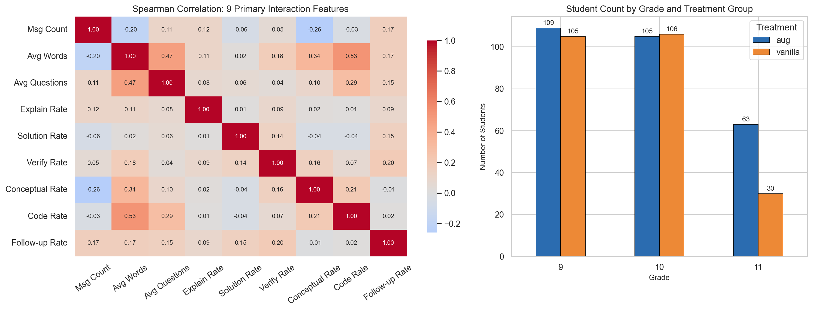

Key EDA findings:
- **Grade–Treatment Imbalance:** While Grades 9 (109 `aug` vs. 105 `vanilla`) and 10 (105 `aug` vs. 106 `vanilla`) are nearly balanced, Grade 11 is heavily skewed toward `aug` (63 `aug` vs. 30 `vanilla`; 67.7% `aug`). A chi-square test confirms a statistically significant grade–treatment association ($\chi^2 = 9.33$, $df = 2$, $p = 0.0094$, Cramér's $V = 0.1342$), motivating explicit grade-stratified evaluation.
- **Skewness & Sparsity:** All behavioural rates are right-skewed with zero medians for rare categories (`explanation`, `verification`, `code`, `followup`), confirming the necessity of `log1p` transformation and non-parametric statistical tests.

---

## 8. Methodology

1. **Unsupervised Learning:** Fit `log1p` + `StandardScaler` on the 9 primary features (excluding `username`, `treatment`, `grade`). Evaluate $k \in \{2, \dots, 8\}$ via Elbow inertia, Silhouette score, Davies–Bouldin index, and Calinski–Harabasz index. Compare K-Means, Agglomerative Clustering (Ward), and Gaussian Mixture Models (GMM). Perform post-hoc $\chi^2$ + Cramér's $V$ tests against `treatment` and `grade`.
2. **Supervised Learning (Unified E1/E2/E3):** Stratified 80/20 train/test split ($n_{\text{train}} = 414$, $n_{\text{test}} = 104$, `random_state=42`). Evaluate 6 classifiers—Dummy Baseline, Logistic Regression, Decision Tree, Random Forest, Gradient Boosting, and HistGradientBoosting—across `E1_Primary`, `E2_Primary_Sparse`, and `E3_Combined_Grade` using 5-fold Stratified Cross-Validation. Select the best behavioural-only and combined models strictly by CV ROC-AUC before evaluating on the untouched hold-out test set.
3. **Explainable AI (SHAP):** Apply `shap.TreeExplainer` to the best behavioural model (`E1_Primary` HistGradientBoosting) and best combined model (`E3_Combined_Grade` Random Forest) to extract global mean $|\text{SHAP}|$, beeswarm distributions, feature-level dependence curves, comparison against permutation importance, and individual student waterfall explanations.
4. **Statistical & Prompt Audit:** Conduct two-sided Mann–Whitney U tests with rank-biserial effect sizes ($r$) and Benjamini–Hochberg FDR correction for `aug` vs. `vanilla`, Kruskal–Wallis tests ($\epsilon^2$) across grades, and a prompt-level coverage audit on all $28{,}664$ messages.

---

## 9. Unsupervised Learning Results

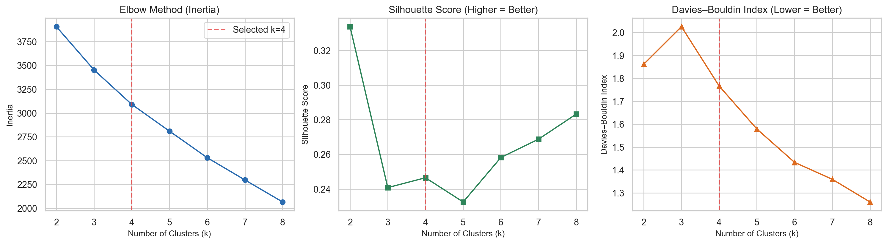

Although $k = 2$ achieved the highest Silhouette score ($0.3338$), it collapsed students into a coarse binary split. Selecting **$k = 4$** (Silhouette = $0.2465$, Davies–Bouldin = $1.7668$, Calinski–Harabasz = $87.07$) outperformed both Agglomerative Ward (Silhouette = $0.2169$, DB = $2.0113$) and GMM (Silhouette = $0.0401$, DB = $2.9433$) while surfacing four distinct, actionable student profiles:

| Cluster | Profile Name | Students ($n$, %) | Mean Msgs | Mean Words | Conceptual Rate | Solution Rate | Code Rate | `aug` / `vanilla` |
|---|---|---:|---:|---:|---:|---:|---:|---:|
| C0 | Brief / Low-Inquiry Users | 124 (23.9%) | 22.8 | 4.89 | 0.140 | 0.105 | 0.005 | 31 / 93 |
| C1 | Student Message Count-Focused Users | 282 (54.4%) | 74.6 | 4.70 | 0.052 | 0.044 | 0.005 | 229 / 53 |
| C2 | Code-Heavy & Verification Users | 73 (14.1%) | 34.9 | 19.08 | 0.191 | 0.051 | 0.111 | 13 / 60 |
| C3 | Followup Prompt-Focused Users | 39 (7.5%) | 43.6 | 8.00 | 0.109 | 0.179 | 0.014 | 4 / 35 |

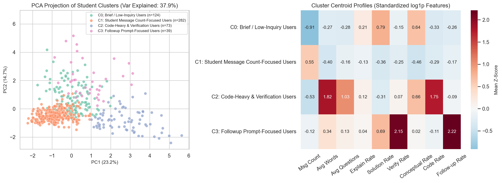

Post-hoc composition analysis reveals a large association between cluster membership and treatment ($\chi^2 = 194.18$, $p < 0.001$, Cramér's $V = 0.6123$): **81.2% of Cluster 1 (high-message-volume users)** belong to `aug`, whereas **82.2% of Cluster 2 (code-heavy & verification users)** and **89.7% of Cluster 3 (follow-up & solution-seeking users)** belong to `vanilla`. Cluster membership also varies significantly by grade ($\chi^2 = 38.04$, $p < 0.001$, Cramér's $V = 0.1916$), notably with only 1 Grade 11 student in the Code-Heavy cluster.

---

## 10. Supervised Learning Results (Step 17: E1 vs. E2 vs. E3 Comparison)

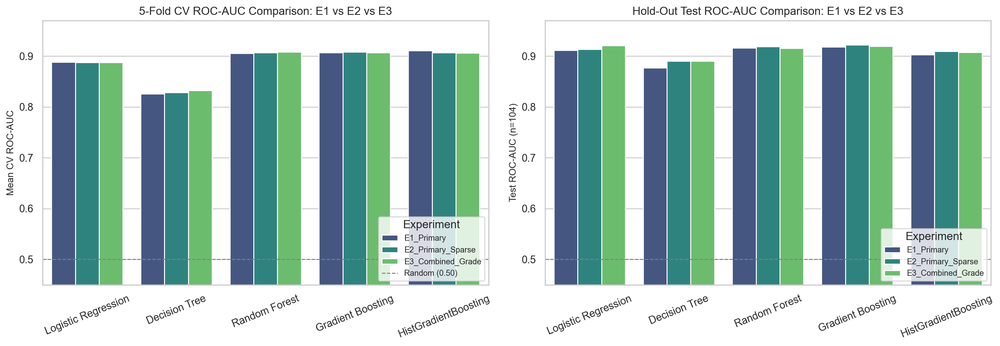

### 5-Fold Stratified CV & Hold-Out Test Summary

| Experiment | Model | CV ROC-AUC (Mean ± SD) | Train ROC-AUC | CV Macro F1 | Test ROC-AUC | Test Macro F1 | Test Accuracy |
|---|---|---:|---:|---:|---:|---:|---:|
| `E1_Primary` | **HistGradientBoosting** *(Best Behav. CV)* | **0.9106 ± 0.0139** | 0.9893 | 0.8197 | 0.9025 | 0.7976 | 0.7981 |
| `E1_Primary` | Gradient Boosting | 0.9067 ± 0.0174 | 0.9934 | 0.8195 | 0.9178 | 0.8173 | 0.8173 |
| `E1_Primary` | Random Forest | 0.9053 ± 0.0206 | 0.9723 | 0.8419 | 0.9159 | 0.7979 | 0.7981 |
| `E1_Primary` | Logistic Regression | 0.8882 ± 0.0305 | 0.9014 | 0.7859 | 0.9111 | 0.8358 | 0.8365 |
| `E2_Primary_Sparse` | Gradient Boosting | 0.9078 ± 0.0171 | 0.9934 | 0.8273 | **0.9222** | 0.8364 | 0.8365 |
| `E2_Primary_Sparse` | HistGradientBoosting | 0.9070 ± 0.0127 | 0.9892 | 0.8293 | 0.9096 | 0.8172 | 0.8173 |
| `E2_Primary_Sparse` | Random Forest | 0.9068 ± 0.0164 | 0.9672 | 0.8425 | 0.9189 | 0.8269 | 0.8269 |
| `E2_Primary_Sparse` | Logistic Regression | 0.8871 ± 0.0325 | 0.9089 | 0.7965 | 0.9133 | 0.8452 | 0.8462 |
| `E3_Combined_Grade` | **Random Forest** *(Best E3 CV)* | **0.9083 ± 0.0186** | 0.9700 | 0.8421 | 0.9156 | 0.8269 | 0.8269 |
| `E3_Combined_Grade` | Gradient Boosting | 0.9068 ± 0.0137 | 0.9938 | 0.8300 | 0.9196 | 0.8362 | 0.8365 |
| `E3_Combined_Grade` | Logistic Regression | 0.8872 ± 0.0266 | 0.9118 | 0.7813 | 0.9204 | **0.8646** | **0.8654** |
| All | Dummy Baseline | 0.5000 ± 0.0000 | 0.5000 | 0.3480 | 0.5000 | 0.3500 | 0.5385 |

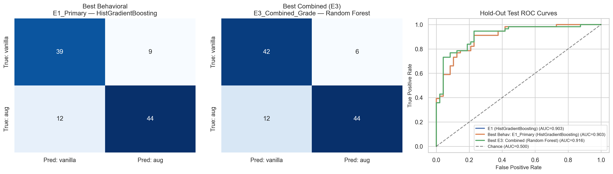

### Key Experimental Findings
- **Strong Behavioral Signal (`E1`):** Pure interaction features lift ROC-AUC from 0.5000 (Dummy) to **0.9106** (CV) and **0.9025–0.9178** (Test). Logistic Regression shows minimal overfitting (Train AUC = $0.9014$ vs. CV = $0.8882$), whereas tree ensembles exhibit moderate train–CV gaps ($0.97$–$0.99$ vs. $0.91$) typical of $n = 414$ tabular samples.
- **Marginal Gain from Sparse Features (`E2` vs. `E1`):** Adding the 6 sparse features yields small test-set improvements (+0.004 to +0.007 ROC-AUC across models), with CV ROC-AUC virtually unchanged ($0.9078$ vs. $0.9106$).
- **Grade Confounding Check (`E3` vs. `E2` & Per-Grade Evaluation):** Adding `grade` in `E3` does **not** inflate CV ROC-AUC ($0.9083$ vs. $0.9106$). Critically, per-grade hold-out evaluation confirms strong discrimination *within* balanced grades alone: for `E1_Primary` HistGradientBoosting, Grade 9 ($n = 54$) achieves ROC-AUC = **0.8772** and Grade 10 ($n = 43$) achieves ROC-AUC = **0.8874** (Grade 11 has only $n = 7$ test records, yielding 1.0000). Thus, treatment separability is not merely an artifact of Grade 11's treatment imbalance.

---

## 11. Explainable AI Analysis (SHAP — Step 18)

### Global Feature Importance & Directional Effects (`E1_Primary` | HistGradientBoosting)

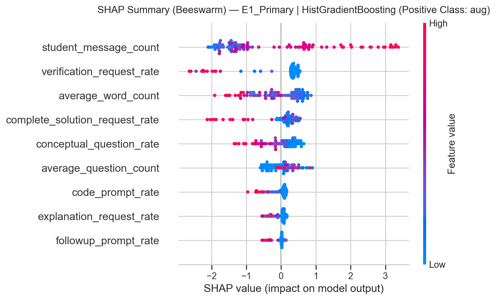

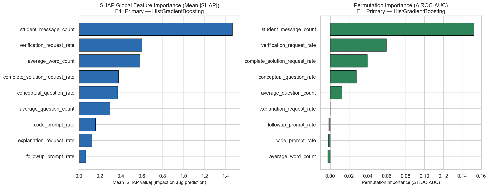

| Rank | Feature | Mean \|SHAP\| (Test) | Mean \|SHAP\| (All 518) | Feature–SHAP Spearman $\rho$ | Direction of Effect | Perm. Imp. ($\Delta$ AUC) |
|---:|---|---:|---:|---:|---|---:|
| 1 | `student_message_count` | **1.4645** | 1.5429 | +0.899 | Higher $\rightarrow$ `aug` (+) | +0.1526 |
| 2 | `verification_request_rate` | **0.6003** | 0.5988 | -0.617 | Higher $\rightarrow$ `vanilla` (-) | +0.0596 |
| 3 | `average_word_count` | **0.5824** | 0.5904 | -0.716 | Higher $\rightarrow$ `vanilla` (-) | -0.0027 |
| 4 | `complete_solution_request_rate` | **0.3772** | 0.3784 | +0.103 | Non-linear (low-mid $\rightarrow$ `aug`, extreme high $\rightarrow$ `vanilla`) | +0.0394 |
| 5 | `conceptual_question_rate` | **0.3691** | 0.3702 | -0.918 | Higher $\rightarrow$ `vanilla` (-) | +0.0277 |
| 6 | `average_question_count` | **0.2957** | 0.2933 | +0.639 | Higher $\rightarrow$ `aug` (+) | +0.0126 |
| 7 | `code_prompt_rate` | 0.1575 | 0.1549 | -0.751 | Higher $\rightarrow$ `vanilla` (-) | -0.0021 |
| 8 | `explanation_request_rate` | 0.1248 | 0.1266 | -0.717 | Higher $\rightarrow$ `vanilla` (-) | -0.0006 |
| 9 | `followup_prompt_rate` | 0.0632 | 0.0498 | -0.232 | Higher $\rightarrow$ `vanilla` (-) | -0.0018 |

### Combined Model SHAP (`E3_Combined_Grade` | Random Forest)

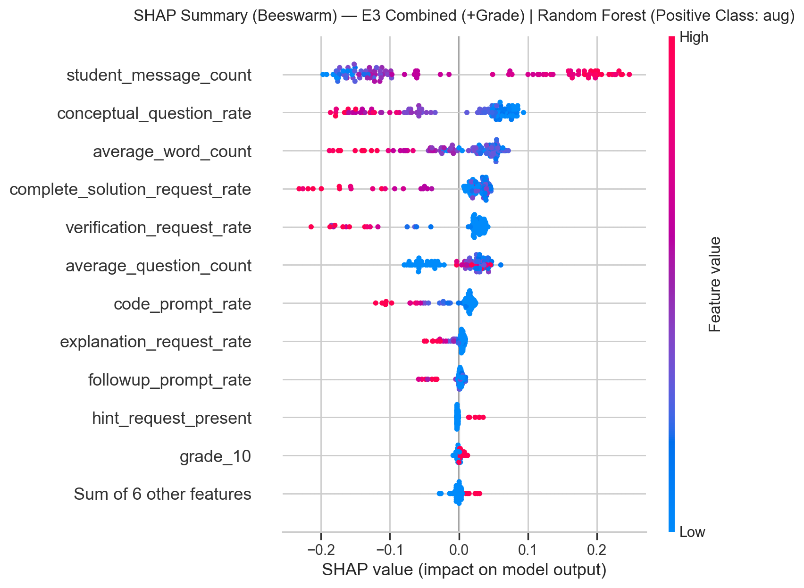

In `E3_Combined_Grade` (Random Forest), the top six features remain **100% behavioural** (`student_message_count`, `conceptual_question_rate`, `average_word_count`, `complete_solution_request_rate`, `verification_request_rate`, `average_question_count`), while `grade_10` and `grade_11` rank near the bottom with negligible mean $|\text{SHAP}|$. This provides direct explainability evidence that the classifier relies on student prompting behaviour rather than grade shortcuts.

### Feature-Level Non-Linear Effects & Individual Student Explanations

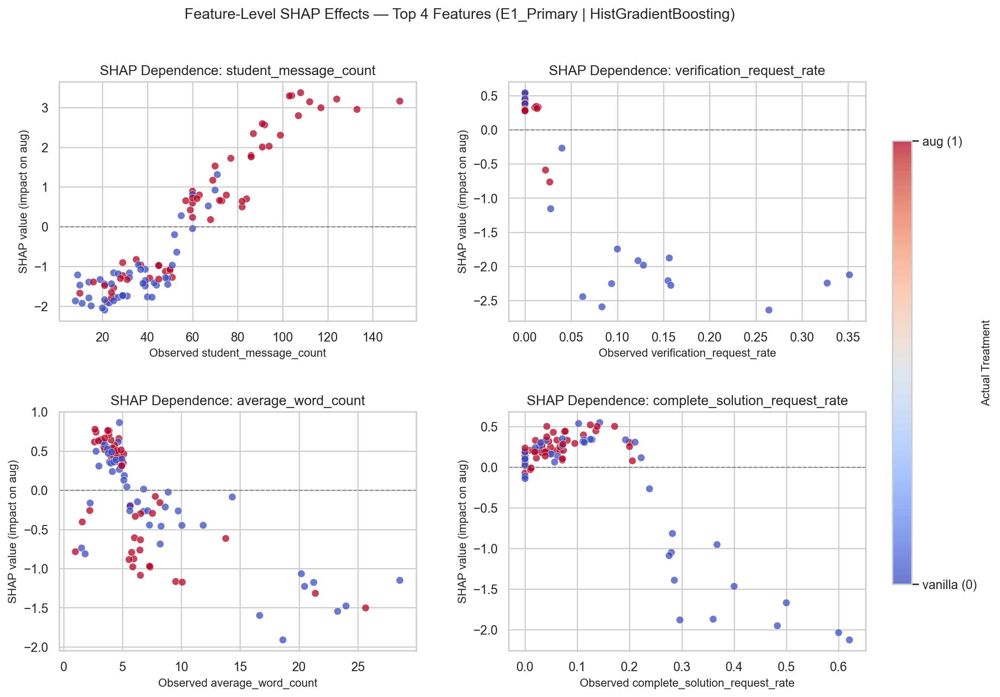

The dependence plots uncover a sharp behavioural threshold:
- **`student_message_count`:** Below ~50 messages, SHAP values are consistently negative ($-1$ to $-2$, pushing toward `vanilla`); above ~60 messages, SHAP values climb steeply to $+3.3$ (`aug`).
- **`verification_request_rate`:** Zero verification requests yield slightly positive SHAP ($+0.3$ to $+0.5$), whereas any rate $> 0.05$ drives SHAP sharply negative ($-1.8$ to $-2.6$, `vanilla`).
- **`complete_solution_request_rate`:** Non-monotonic relationship—low-to-moderate rates ($0.02$–$0.20$) slightly favour `aug`, whereas extreme solution delegation ($> 0.25$) strongly pushes predictions toward `vanilla` ($-1.0$ to $-2.1$).

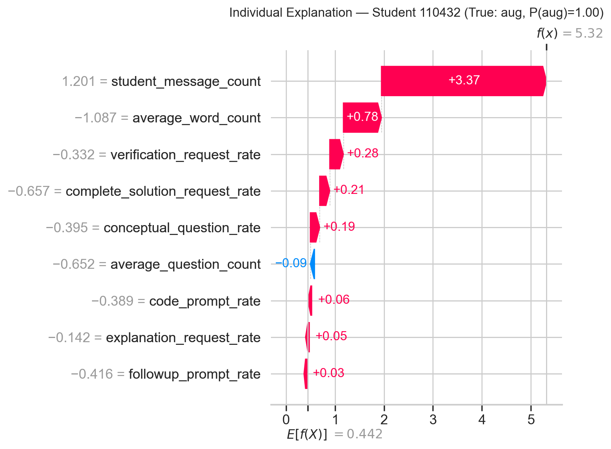
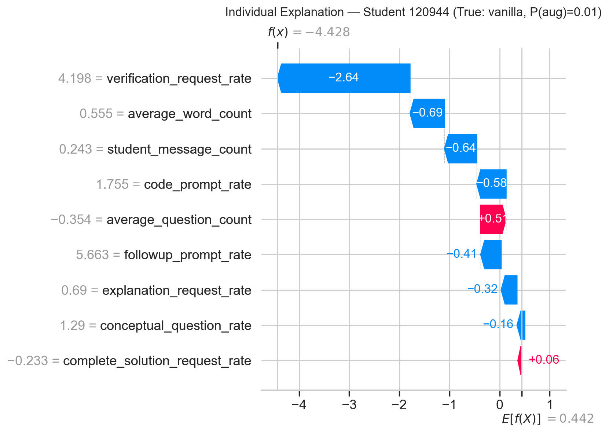

For Student `110432` (True: `aug`, $P(\text{aug}) = 0.9951$), high message count ($+3.37$) and concise prompts (`average_word_count`, $+0.78$) dominate the log-odds push above the baseline $E[f(X)] = 0.442$. Conversely, for Student `120944` (True: `vanilla`, $P(\text{aug}) = 0.0118$), low message count and higher verification/conceptual rates drive the prediction decisively below zero.

---

## 12. Discussion & Statistical Interpretation (Step 19)

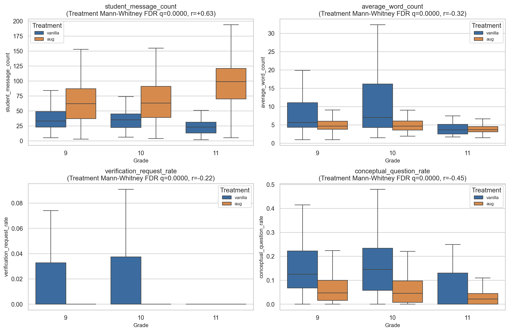

Non-parametric Mann–Whitney U tests (Benjamini–Hochberg FDR-adjusted) independently corroborate the SHAP rankings:
- **`student_message_count`:** `aug` median = **70.0** vs. `vanilla` median = **32.0** ($q < 0.0001$, rank-biserial $r = +0.630$ — large effect).
- **`conceptual_question_rate`:** `aug` median = **0.0385** vs. `vanilla` median = **0.1250** ($q < 0.0001$, $r = -0.450$ — medium-to-large effect).
- **`average_word_count`:** `aug` median = **4.38** vs. `vanilla` median = **5.81** ($q < 0.0001$, $r = -0.323$ — medium effect).
- **`verification_request_rate`:** Significantly higher in `vanilla` ($q < 0.0001$, $r = -0.216$).
- **`code_prompt_rate` & `complete_solution_request_rate`:** Significantly higher in `vanilla` ($q = 0.0002$, $r = -0.153$; and $q = 0.0262$, $r = -0.122$).
- **`hint_request_rate`:** Slightly higher in `aug` ($q < 0.0001$, $r = +0.118$), consistent with `hint_request_present` appearing positively in `E3` SHAP.

**Behavioral Synthesis:** Students in the `aug` condition engage in substantially more back-and-forth turns using shorter prompts (~4.4 words/prompt, median 70 messages), whereas students in the `vanilla` condition send fewer, longer prompts (~5.8 words/prompt, median 32 messages) with higher proportions of explicit conceptual questions, answer-verification requests, and code snippets. Kruskal–Wallis tests also reveal significant grade-level differences in `code_prompt_rate` ($\epsilon^2 = 0.169$, $q < 0.0001$) and `average_word_count` ($\epsilon^2 = 0.088$, $q < 0.0001$), with Grade 11 students writing shorter, more frequent messages.

---

## 13. Limitations

1. **No Independent Academic Outcome:** `student_features_final.csv` does not include exam scores, grades, or post-tests. Neither model accuracy nor SHAP values establish that `aug` or `vanilla` improves learning.
2. **Observational / Non-Causal Scope:** SHAP quantifies how each feature contributes to the model's predicted log-odds or probability of `treatment`, not the causal effect of changing a student's prompting style.
3. **Rule-Based Labelling Coverage:** Our prompt-level audit of `cleaned_user_messages.csv` ($28{,}664$ messages) shows that **79.82% of messages trigger none of the nine keyword rules** (only 20.18% receive at least one behavioural label). While the cleaned text contains 0 non-ASCII characters (likely stripped during earlier cleaning), short conversational replies, typos (e.g., `"prme number is what"`), and implicit requests are under-detected without human-validated NLP classifiers.
4. **Grade 11 Sample Size & Imbalance:** Grade 11 has only $n = 93$ students (67.7% `aug`) and $n = 7$ in the 20% hold-out split, limiting statistical power for Grade 11-specific hold-out estimates.
5. **Tree Overfitting Gap:** Gradient boosting models show a ~0.08 gap between training and CV ROC-AUC, which is why CV-selected models and simpler Logistic Regression baselines (CV AUC = $0.888$, Test AUC = $0.911$–$0.920$) are reported side by side.

---

## 14. Conclusion

Unifying Srijan's preprocessed student dataset, Shivesh's `E1`/`E2`/`E3` experimental structure, and Shreyansh's clustering, classification, and SHAP explainability workflow demonstrates that student–LLM interaction patterns robustly differentiate the `aug` and `vanilla` treatment groups (CV ROC-AUC up to **0.9106**, test ROC-AUC up to **0.9222**). Both unsupervised clustering (Cramér's $V = 0.6123$) and SHAP explainability converge on the same core behavioural signature: `aug` interactions are characterized by high-frequency, concise conversational turns, while `vanilla` interactions involve fewer, longer prompts with higher rates of conceptual questioning, verification, and code sharing.

---

## 15. Future Work

1. **Link Independent Learning Outcomes:** Merge pre/post-test or assignment scores when available to test whether the discovered interaction profiles predict actual learning gains.
2. **Human-Validated NLP Classification:** Annotate a stratified sample of the 79.82% unlabelled prompts and train a lightweight transformer/LLM classifier to replace brittle keyword regexes.
3. **Session-Level Trajectory Modeling:** Leverage `session_id` (Sessions 1–4) in `cleaned_user_messages.csv` to analyze whether student prompting strategies evolve over time within each treatment group.

---

## 16. Reproducibility & References

### Reproducibility Details
- **Python:** 3.13.1 | **pandas:** 2.2.3 | **numpy:** 2.4.4 | **scikit-learn:** 1.6.1 | **shap:** 0.54.1 | **scipy:** 1.15.2
- **Random Seed:** `SEED = 42` applied across splits, cross-validation, clustering, and all estimators.
- **Execution:** Run `python3 run_full_pipeline.py` inside `focus on/` or open `Student_LLM_Unified_Pipeline_SHAP.ipynb` in Google Colab. All generated tables (`outputs/tables/*.csv`), figures (`outputs/figures/*.png`), and exact metrics (`outputs/summary_metrics.json`) are reproduced deterministically.

### Methodological References
- Lundberg, S. M., & Lee, S.-I. (2017). *A Unified Approach to Interpreting Model Predictions* (SHAP). Advances in Neural Information Processing Systems (NeurIPS).
- Pedregosa, F., et al. (2011). *Scikit-learn: Machine Learning in Python*. Journal of Machine Learning Research, 12, 2825–2830.
- Rousseeuw, P. J. (1987). *Silhouettes: A graphical aid to the interpretation and validation of cluster analysis*. Journal of Computational and Applied Mathematics, 20, 53–65.
- Benjamini, Y., & Hochberg, Y. (1995). *Controlling the False Discovery Rate: A Practical and Powerful Approach to Multiple Testing*. Journal of the Royal Statistical Society: Series B, 57(1), 289–300.
